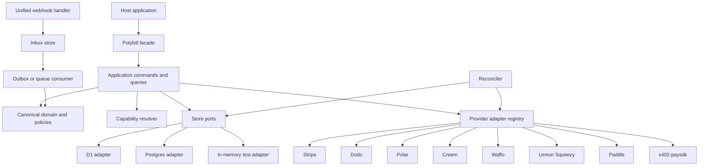

# 总体架构

## 1. 设计原则

Polybill 采用 ports-and-adapters。核心领域不依赖 provider SDK、数据库、框架或特定运行时；
provider adapter 把 canonical command 翻译为远端 API，再把远端对象与事件翻译回来。



## 2. Public facade

公共入口只组合稳定的 resource clients：

```ts
const billing = createPolybill({
  connection: {
    provider: "polar",
    environment: "test",
    credentials: () => ({ accessToken: env.POLAR_ACCESS_TOKEN }),
  },
  store: createD1Store(env.POLYBILL_DB),
  crypto: webCryptoProvider(globalThis.crypto),
  clock: systemClock,
  fetch: globalThis.fetch,
});

const checkout = await billing.checkouts.create({
  idempotencyKey: "checkout:order_01J...",
  customer: { externalId: "user_123", email: "buyer@example.com" },
  items: [{ skuId: "sku_pro_monthly", quantity: 1 }],
  successUrl: "https://app.example.com/billing/success",
  cancelUrl: "https://app.example.com/billing",
});
```

Facade 公开 `catalog`、`customers`、`checkouts`、`orders`、`payments`、`refunds`、
`subscriptions`、`discounts`、`licenses`、`vouchers`、`usage`、`migrations`、
`webhooks` 和 `reconcile`。每组 API 都依赖较小的 port，不形成一个巨型 adapter interface。

宿主可在 composition root 设置 `commercialPolicy`，例如 `sellerOfRecord: "provider_required"`、
`taxInvoice: "provider_required"`。application 在创建 checkout 前对照 connection 的动态
`CommercialTermsSnapshot`；不兼容时返回 capability diff，不发远端请求。

## 3. Configuration and connection isolation

`ProviderConnection` 是第一等实体：

```ts
type ProviderName =
  | "stripe" | "dodo" | "polar" | "creem"
  | "waffo" | "lemonSqueezy" | "paddle" | "x402";

type Environment = "test" | "live";

interface ConnectionRef {
  readonly id: ConnectionId;
  readonly tenantId: TenantId;
  readonly provider: ProviderName;
  readonly environment: Environment;
  readonly accountRef?: string;
}
```

- `connectionId` 参与每个 mapping、inbox、outbox、idempotency 和 audit key。
- test object 永远不能作为 live command 的 input；mapping lookup 必须同时匹配 environment。
- credential resolver 每次按需返回 provider-specific secret，便于 Workers secret binding、密钥
  轮换和测试注入。
- 默认 base URL 由 adapter 根据环境选择；自定义 base URL 只在测试或显式 allowlist 下启用。

## 4. Canonical command path

每个写命令遵循同一顺序：

1. runtime schema 验证并 canonicalize input。
2. 读取 capability snapshot，确定 `native`、允许的 `emulated` 策略或拒绝。
3. 在 store 中 claim `(tenant, connection, operation, idempotencyKey)`。
4. 解析 Polybill ID 到 provider mapping，生成 provider request。
5. 发起带超时、request ID 和 provider idempotency header 的请求。
6. 对 response 作 runtime validation，不信任 SDK TypeScript 类型。
7. 同一原子提交中写 snapshot、mapping、audit event 和 outbox；不能原子时使用可恢复状态机。
8. 返回 canonical result，并通过 `providerEvidence` 暴露脱敏诊断引用。

超时发生在“远端可能已成功”之后时，命令进入 `outcome_unknown`，先用 idempotency key 或
provider query 恢复，禁止盲目重复创建。

## 5. Capability-driven portability

可移植性不是取所有 provider 的最小交集。每个 capability 带实现等级、输入约束和迁移等级：

```ts
interface CapabilityBase {
  readonly environments: readonly Environment[];
  readonly constraints: Readonly<Record<string, unknown>>;
  readonly limits?: CapabilityLimits;
  readonly migration: "portable" | "recreate" | "reauthorize" | "pinned";
}

type CapabilityDescriptor =
  | (CapabilityBase & { support: "native"; fidelity: "exact" })
  | (CapabilityBase & {
      support: "emulated";
      fidelity: "exact" | "lossy" | "workflow";
      strategy: string;
    })
  | (CapabilityBase & {
      support: "unsupported";
      reason: string;
      alternatives?: readonly string[];
    });
```

- `exact/native`：可直接执行且 canonical 语义不丢失。
- `exact/emulated`：由 Polybill store/worker 完成，例如 license key。
- `lossy/emulated`：必须由调用者显式 opt-in，并返回 loss report。
- `workflow/emulated`：能力只能通过用户或 provider 人工步骤完成，例如每期重新授权或 card
  token migration；不能以同步成功响应冒充已自动完成。
- `unsupported`：在任何远端请求前抛结构化错误。

provider 切换时，planner 计算源与目标 capability diff。只有 `portable` 或成功完成
`recreate` 的对象自动切换；`reauthorize` 和 `pinned` 保留在旧 connection。

## 6. Source of truth

不同数据有不同真源，不能用一个“同步 DB”概念掩盖：

| 数据 | 权威真源 | Polybill 角色 |
| --- | --- | --- |
| Product/SKU intent | Polybill 或宿主 catalog | 映射和发布到 provider |
| Provider price/tax config | Provider | 保存 snapshot 并检测 drift |
| Order intent | 宿主或 Polybill | 用 external ID 关联，不接管 fulfillment |
| Payment/Refund/Dispute fact | Provider 或 chain | 保存归一化 projection 和 evidence |
| Active mandate/payment method | Provider | 仅保存 opaque reference |
| Subscription billing state | Provider | projection、策略和 reconciliation |
| Entitlement/license/voucher | Polybill | 原生真源；可镜像 provider benefit |
| x402 settlement | signed receipt + chain | 验证并投影为 Payment |
| Tax invoice and legal seller | MoR | 只保存 reference/URL/metadata |

订单和目录的计价金额始终是 ISO-4217 `Money`。x402 等数字资产支付另保存 `AssetAmount`；
`SettlementQuote` 把订单总额绑定到 network、asset contract、decimals、atomic amount 和有效期。
固定 USD/USDC 面值策略也必须是商户显式配置并记录为 quote source，不能在 adapter 中暗含汇率。

### Commercial responsibility is not portable state

`CommercialTermsSnapshot` 单独记录 seller of record、tax calculation/collection、invoice issuer、
refund/dispute responsibility、适用地区、条款版本和 observed time。它属于 connection/account 的
动态合同事实，不从“能创建 checkout”推断。Stripe 基础支付通道、MoR 服务和 x402 settlement 的
支付状态可以统一，但法律责任不能互换。

provider 切换若改变责任，planner 生成 `legal_responsibility_change` blocker。只有宿主显式采用新的
commercial policy、完成税务/条款审查并留下 acknowledgement evidence 后才能继续；SDK 的 opt-in
不是法律结论，也不替代合规 owner review。

## 7. Payment finality model

统一 `Payment.status = succeeded` 只表示 provider 已确认可视为成功，不代表所有支付方式不可
逆。`risk` 和 `settlement` 单独表达：

```ts
interface PaymentEvidence {
  readonly authority: "provider_api" | "provider_event" | "x402_receipt" | "chain";
  readonly observedAt: IsoDateTime;
  readonly finality: "provisional" | "confirmed" | "finalized";
  readonly reference: string;
}
```

- card success 仍可能 dispute；dispute 是后续状态，不回写历史事件。
- async bank/local method 在 provider 明确 paid/completed 前保持 `processing`。
- webhook 事件默认只是 `provider_event/provisional`，高价值 side effect 可要求 API re-fetch。
- x402 要求 receipt 签名有效且链上 confirmations 达到配置阈值。

## 8. Store architecture

最低可移植能力需要少量控制面状态。`PolybillStore` 被拆成以下原子 ports：

- `MappingStore`
- `IdempotencyStore`
- `InboxStore`
- `OutboxStore`
- `SnapshotStore`
- `CatalogStore`
- `EntitlementStore`
- `LicenseStore`
- `VoucherStore`
- `MigrationStore`
- `AuditStore`

宿主可实现这些 port，或采用官方 adapter。所有表使用 `polybill_` 前缀，外键只指向
Polybill ID 或保存宿主 opaque external ID；不会向宿主 user/order 表添加 foreign key。

Cloudflare 默认实现使用 D1 保存 control plane、Queue 处理 outbox、Durable Object 或 D1
条件更新处理高竞争 redemption。KV 只能缓存 capability、public catalog 和短期读取结果，
不能作为支付幂等或单次兑换真源。

多语句写入通过 `@polybill/store-d1` 的 `D1WriteCoordinator` 防腐层执行。默认使用 D1
`batch`；不具备事务批处理能力的部署可注入 `mode: "sequential"`。顺序模式要求 SQL
具备幂等键和确定性顺序，部分失败会抛出 `d1_write_partial_failure`（包含已完成语句数），
由上层重试或对账收敛。业务代码不得直接调用 `D1DatabaseLike.batch`。退款快照、支付退款
累计额和订单支付状态必须作为一个 `commitResources` 资源组提交；顺序模式下每条语句仍需
可重放，不能把先写退款、后写支付的半套账务当成成功。

## 9. Event architecture

事件有三层：

1. `RawProviderEvent`：验签后的原始证据和 headers 摘要。
2. `CanonicalBillingEvent`：版本化、provider-neutral 的事实。
3. `ApplicationEvent`：宿主按自身订单/权限策略派生的动作。

只有第一层成功写入 inbox 后才 ack。第二层通过 queue/outbox 生成；第三层由宿主 consumer
决定。这样升级 schema 或修复 mapper 时可回放，不需要供应商重发 webhook。

## 10. Framework boundary

核心 webhook handler 形如 `(request: Request) => Promise<Response>`。框架包只负责获取 raw
body 和 route params：

- `@polybill/webhooks/hono`
- `@polybill/webhooks/next`
- `@polybill/webhooks/node`
- Cloudflare Worker 直接使用 Web handler，无额外 adapter。

框架 helper 不包含业务逻辑，也不隐式创建数据库连接。

## 11. Failure and recovery

- 所有外部调用记录 phase：`claimed -> sent -> observed -> committed -> published`。
- `sent` 后超时进入未知结果，通过 provider query/reconcile 恢复。
- inbox consumer 使用 lease + attempt counter；毒消息进入 dead letter，不阻塞同 connection。
- outbox 发布至少一次，消费者按 event ID 幂等。
- provider 限流按 connection 分桶；尊重 `Retry-After` 并加入 jitter。
- circuit breaker 只阻止新请求，不改变已经确认的账务状态。

## 12. 不采用的方案

- 不以 Stripe object model 作为 canonical model：它会把其他 MoR 强行变成 Stripe 的子集。
- 不让所有 adapter 实现一个数百方法的接口：会产生空实现和运行时 surprise。
- 不依赖 webhook 完成测试或最终一致性：提供 fixture、fake server 和 reconciliation。
- 不把 provider raw JSON 直接暴露给宿主状态机：升级 API 时会破坏可移植性。
- 不使用浮点金额，也不在 JSON public API 暴露 JavaScript `bigint`。
- 不把 Node vendor SDK 放进 core bundle：Cloudflare compatibility 必须是结构性的。
