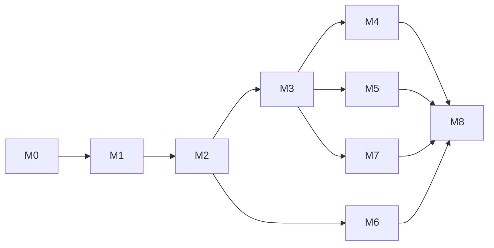

# 实现里程碑与交付顺序

## 1. 估算口径

以下估时使用“工程周”，便于团队大小变化后换算；1 工程师连续投入 1 周即 1 工程周。总量约
38-56 工程周，不含 provider 审核/KYB 等外部等待时间。两个熟悉 billing 与 Cloudflare 的工程师
可并行到约 5-7 个自然月，但 provider 验证、合规 review 和真实迁移不能简单按人数线性压缩。

每个 milestone 都必须满足共同 Definition of Done：类型和 runtime schema 完整、Cloudflare 默认
入口无 Node built-in、文档/capability 更新、离线测试通过、changeset（若影响发布 API）以及
`xxx(comp): desc` 提交规范。不能为了赶进度把未知能力标成 `native`。

## 2. M0 仓库与决策基线

估时：1-2 工程周。

交付：

- pnpm workspace、TypeScript strict、ESLint/Prettier、Vitest、Changesets 和 package/release checks。
- `.agents` 架构基线、根 `AGENTS.md`、开发 skill、ADR/changeset 约定。
- Cloudflare Worker 和 Node 最小 build smoke；CI secret policy 与 dependency direction check。
- provider capability manifest schema 和 research verification checklist。

退出条件：空的 Worker composition root 在无 `nodejs_compat` 下运行；错误的包依赖和 `node:*`
import 会使 CI 失败；公共金额/ID/环境类型有 compile-time fixture。

主要风险：过早创建大量空 package。控制方式是只建立工具链和立即使用的包，后续逐 milestone
增加 workspace member。

## 3. M1 Canonical core、adapter kit 与 fake provider

估时：4-6 工程周。

交付：

- `core` 的 Money、ID、Product/SKU/Price、Customer、Order、Payment、Refund、Subscription。
- capability snapshot、错误、evidence、provider context、resource ports 和 HTTP transport。
- `application` command/query 骨架、idempotency phase 状态机和 connection registry。
- `testing` 的 fake provider、scripted fetch、virtual clock、deterministic ID 和 conformance runner。
- memory store 与第一个 reconciliation-first E2E。

退出条件：同一 checkout/subscription canonical suite 可在两个配置不同的 fake connection 上运行；
unsupported 在 transport 前失败；response-lost 场景不重复远端 create；property tests 覆盖核心金额
和状态机不变量。

主要风险：canonical model 被第一个 provider 的对象形状绑架。控制方式是先完成 capability 与
loss report，再接真实 adapter，并用至少三种不同 provider fixture review 模型。

## 4. M2 Control-plane store、webhook 与 entitlement

估时：5-7 工程周。

交付：

- Store ports、memory/D1 adapters、schema migration、inbox/outbox/audit/mapping/idempotency。
- 统一 Web `Request` webhook handler、queue consumer、dead letter、replay 和 reconciliation scheduler。
- License、activation、entitlement、数字卡/voucher batch、原子兑换和 key encryption/digest。
- Cloudflare Worker 示例：D1 + Queue + Durable Object（高竞争兑换场景）。
- store/webhook/licensing conformance 与安全负向测试。

退出条件：无公网 webhook 的 Miniflare E2E 完成签名 fixture ingest、queue apply、outbox 和 license
grant；100 个并发单次兑换恰好一个成功；duplicate/out-of-order/unknown event 不重复 side effect；
D1 从空库和上一 schema 均可升级。

主要风险：D1 事务/一致性与多 isolate 竞争不符合内存实现假设。控制方式是 Store contract 先定义
原子原语，关键兑换采用条件更新或 DO 串行化，不把 KV 当真源。

## 5. M3 Provider wave A：Stripe 与 Dodo Payments

估时：6-8 工程周。

选择理由：Stripe 提供成熟支付/订阅基准，Dodo 提供 MoR、原生 license/dynamic pricing 和不同的
迁移约束，两者可以尽早暴露 canonical 设计偏差。

交付：

- 固定 API version 的窄 fetch clients、runtime codecs、capability manifests 和 official-source notes。
- Product/Price、Customer、hosted checkout、one-time、basic subscription/cancel/change、refund。
- Stripe/Dodo raw webhook verify/decode/map、list/get reconciliation 和 importer dry-run。
- Dodo native license mirror；Polybill-owned entitlement 保持真源。
- offline fixtures 全矩阵；可选 Stripe CLI/test clock 与 Dodo test job。

退出条件：两个 adapter 全部通过共同 conformance、签名 known vectors、reconciliation-first E2E 和
workerd bundle；改一个 connection 配置即可让同一新订单测试从 Stripe 切到 Dodo；capability
losses 在请求前可见；没有 sandbox secret 的 CI 仍全绿。

主要风险：Stripe 语义成为默认模型、Dodo token migration 被误解为自动能力。控制方式是 portable
test 只依赖 canonical capability，迁移输出默认 `reauthorize`，provider-assisted 流程单独建模。

## 6. M4 Provider wave B：Polar、Creem 与 Lemon Squeezy

估时：7-10 工程周。

交付：

- 三个 adapter 的目录、客户、checkout、基础订阅、refund、portal 和 webhook/reconcile。
- Polar benefit、Creem/Lemon native license 映射为可选发行/mirror 后端。
- custom/pay-what-you-want/ad hoc price 的主体选择和 persistence 约束。
- Creem/Lemon existing-system importer fixture 与 active subscription dual-run plan。
- 每家独立 sandbox smoke（有凭据时）和完整 offline contract suite。

退出条件：所有 native 声明有成功/失败协议 fixture；provider 原生 license 不绕过 Polybill grant；
乱序 subscription 事件由 GET 收敛；迁移 dry-run/resume/verify 不产生重复对象；Cloudflare bundle
不静态引用 Node-only vendor SDK。

主要风险：三家 API 与 webhook schema 演进快。控制方式是固定 API/schema version、fixture
provenance、unknown event 保存和 weekly/nightly drift job。

## 7. M5 Provider wave C：Paddle Billing 与 Waffo Pancake

估时：5-8 工程周。

交付：

- Paddle Billing（不混用 Classic）目录、non-catalog price、customer、transaction/subscription、
  refund、webhook simulator fixture 和 reconciliation。
- Waffo Pancake 的 Web Crypto + REST adapter、RSA request/webhook signing、目录/checkout/subscription
  已确认能力和 refund ticket workflow。
- 两家 catalog importer、loss report、active subscription/source-pinned 策略。
- Paddle application-owned fulfillment 与 Waffo Polybill-owned license 明确建模。

退出条件：Paddle simulator fixture 与 Waffo RSA known vectors 通过；Waffo 默认 Worker bundle 不含
`node:crypto`；Coming Soon/未核实 API 保持 unsupported；Billing fixture 不接受 Paddle Classic
对象；Waffo 官方迁移限制在 report 中可见。

主要风险：Waffo 文档能力仍变化、Paddle Classic/Billing 名称混淆。控制方式是 adapter descriptor
固定产品线和验证日期，未核实能力维持 experimental/unsupported。

## 8. M6 x402 一次性结算

估时：3-5 工程周。

交付：

- `@polybill/provider-x402` 包装 `x402-paysdk/merchant` 公共入口。
- PaymentRef/Order mapping、signed receipt、notify nonce、chain finality、recovery/reconcile。
- 满足 SDK/网络能力时的 conditional refund；不满足时显式 unsupported。
- fake gateway/facilitator、fake chain/RPC、D1 nonce store 和 workerd E2E。
- 每周期重新授权的 scheduled invoice workflow，不暴露 recurring mandate。

退出条件：伪造/tamper/错 network/amount/payTo/insufficient confirmations 全部拒绝；settled-but-
response-lost 可恢复且只生成一个 Payment；重复 tx hash 不能支付两个订单；notify 完全缺失仍可通过
reconcile 收敛；无私钥/资金进入普通 CI。

主要风险：把 notify 当最终性、复制 x402 协议造成漂移。控制方式是复用公开验证 helper，expected
settlement tuple 与 chain read-back 都通过后才 succeeded。

## 9. M7 Migration toolkit 与渐进接管

估时：4-6 工程周。

交付：

- observe-only、shadow-read、new-sales-cutover、dual-run、full-control 五种运行模式。
- analyze/plan/dry-run/apply/checkpoint/resume/verify/cutback library 和 CLI shell。
- Provider API scanner、host data bridge、mapping/conflict report、cohort routing 和 kill switch。
- Stripe/Lemon/Creem 等典型宿主 fixture、catalog conversion、subscription strategy planner。
- 可选 codemod/窄兼容 helper 和无法自动转换清单。

退出条件：示例已有系统无需改变 user/order schema 即可 observe + reconcile；dry-run 的 transport
write count 为 0；中断后 resume 与重复 apply 不重复创建；active subscription 每项都有 migrated/
reauthorize/dual-run/pinned 结果；cutback 保留财务历史且新销售路由可恢复。

主要风险：通过 email/name 猜 identity 或声称无损搬 token。控制方式是 mapping 优先、模糊匹配只
产 candidate，token 仅走 provider-assisted workflow。

## 10. M8 Hardening、RC 与 stable v1

估时：3-4 工程周，另加 2-4 周受控 beta 观察期。

交付：

- public API report、migration guide、operational runbook、compatibility matrix 和 threat-model review。
- 全 provider fixture replay、D1 upgrade、Queue/DO 压测、bundle/package/provenance audit。
- 至少 Stripe + 一家 MoR 的 sandbox E2E；其余无可用账户者明确 experimental 状态和证据缺口。
- release candidate、changesets、semver policy、deprecation 和 provider API drift process。
- example-worker/example-node 展示同一业务代码仅更换 connection 配置。

退出条件：一期验收标准全部满足；critical/high 安全问题为 0；required CI 连续稳定；故障演练证明
webhook 全停、provider timeout、queue redelivery 和 migration cutback 可恢复；stable adapter 每个
native capability 有可追溯官方来源、offline proof 和至少一次 compatibility verification。

主要风险：六家 MoR、Stripe PSP 与 x402 同时 stable 导致“标称支持大于验证支持”。控制方式是 package 独立
成熟度 `experimental | preview | stable`，总 SDK v1 不强迫未达 gate 的 adapter 冒充 stable。

## 11. 并行策略与关键路径

M0 -> M1 -> M2 是不可跳过的主链。M3 完成并反哺 conformance 后，M4、M5 和 M6 可由不同工程师
并行；M7 可在 M3 后开始，但需要各 wave 补 provider importer。M8 必须等待目标 stable adapter、
store/webhook/licensing 和 migration gate。

优先级发生变化时，可以减少首批 stable adapter 数量，不能削弱 conformance、安全或迁移诚实性。

## 12. 发布成熟度与停止条件

| 等级 | 允许承诺 | 必要证据 |
| --- | --- | --- |
| Experimental | API/能力可能调整 | codec + offline fixtures，清楚列出未验证项 |
| Preview | 可用于受控 test 集成 | conformance + workerd + migration dry-run + sandbox smoke |
| Stable | semver/生产支持 | 全 release gate、兼容性记录、runbook、升级/回滚路径 |

遇到以下情况必须阻断某 adapter 发布，而不是降级测试：无法确认 MoR/产品线、验签输入或 base URL；
响应无法 runtime decode；金额/币种/proration 语义不明确；mutation 没有安全幂等/恢复路径；默认
Worker bundle 引入 Node-only 依赖；native capability 没有离线场景或实际兼容性证据。

外部 sandbox 不可用不是整个项目的阻断项。对应 adapter 维持 experimental，并继续用官方资料、
sanitized fixture、独立签名向量、scripted transport 和 reconciliation 证明已知语义；待拿到账号后
补 compatibility gate，再提升成熟度。
