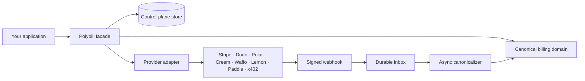

# Polybill

### Provider-neutral billing for TypeScript and Cloudflare Workers

Polybill gives your product one canonical billing model while payment providers change behind an
adapter boundary. Keep your catalog, orders, payments, refunds, subscriptions, entitlements, and
vouchers portable—and make failure recovery explicit.

<p>
  
  
  
</p>

> **Status:** experimental. Adapters have deterministic offline and Worker coverage, but no provider
> is promoted to stable until sandbox and production evidence is recorded. Do not use this
> repository as proof of payment compliance or provider compatibility.

## Why Polybill?

Payment integrations usually spread provider IDs and statuses through business code. That makes a
provider switch expensive and turns timeouts, duplicate webhooks, and partial failures into
accounting bugs. Polybill keeps the business model provider-neutral and treats every external
response as evidence that must be validated.

- **One domain model:** branded IDs, decimal minor-unit money, immutable prices, explicit lifecycle
  states.
- **Failure-aware mutations:** idempotency is claimed before transport; unknown outcomes recover
  through provider read-back or reconciliation instead of blind retries.
- **Webhook safety:** verify raw bytes, persist an inbox record, then canonicalize asynchronously.
  Duplicate and out-of-order delivery is expected.
- **Tenant and environment isolation:** test/live credentials, mappings, evidence, and idempotency
  keys cannot cross connection boundaries.
- **Edge-first runtime:** the default import graph is Web API and Cloudflare Workers friendly; Node
  helpers live in an explicit example app.
- **Portable entitlements:** licenses, vouchers, and redemption state belong to Polybill and survive
  a provider migration.

## Supported adapters

All adapters are currently `experimental`; capability snapshots report whether an operation is
`native`, `emulated`, or `unsupported`.

| Provider       | Package                           | Notes                                                            |
| -------------- | --------------------------------- | ---------------------------------------------------------------- |
| Stripe         | `@polybill/provider-stripe`       | Checkout, payment, refund, subscription and webhook flows        |
| Dodo Payments  | `@polybill/provider-dodo`         | Hosted checkout, MoR billing and text/image moderation           |
| Polar          | `@polybill/provider-polar`        | Product alternatives; canonical multi-item carts are unsupported |
| Creem          | `@polybill/provider-creem`        | Hosted checkout, native customer credits and prompt moderation   |
| Waffo Pancake  | `@polybill/provider-waffo`        | Hosted checkout, customer portal SSO and signed webhooks         |
| Lemon Squeezy  | `@polybill/provider-lemonsqueezy` | Existing stores and migration. Payments end 2027-03-31           |
| Paddle Billing | `@polybill/provider-paddle`       | Billing checkout and full refunds                                |
| x402           | `@polybill/provider-x402`         | One-time USDC settlement through `x402-paysdk`                   |

Direct recurring mandate portability, provider-native license ownership, and financial-card issuance
are intentionally outside the current contract.

Polar requests default to `2026-10`; `createPolarAdapter({ apiVersion: "2027-01" })` selects the
reviewed Next version. Every response must confirm the selected version. Set each Polar webhook
endpoint's `api_version` separately; existing events retain their original version on redelivery.
See the [Polar compatibility guide](./packages/provider-polar/README.md) for upgrades and drift
checks.

## Architecture



The control-plane store is deliberately small. Polybill does not take over your user table or
business order table. Use the memory store for tests and local experiments; use D1 (or another
implementation of the store ports) for durable deployments.

Custom stores must implement atomic `replaceResource` version checks for subscription snapshots.
Reconciliation scans restart after an empty terminal page and keep report/projection checkpoints
separate. See the [store upgrade contract](./.agents/PUBLIC_API.md#compatibility-rules).

自定义 store 必须实现 `replaceResource`
原子版本校验，防止旧订阅快照覆盖新状态。对账扫到空的末页后，下次调用会重新扫描；报告与修复使用独立进度。内置 memory/D1 已适配。

## Quick start

Requirements: Node.js 20+, pnpm 12.3.4+.

```bash
git clone https://github.com/backrunner/polybill.git
cd polybill
pnpm install
pnpm build
pnpm test
```

The Node example starts a local webhook endpoint and capability endpoint:

```bash
pnpm --filter @polybill/example-node build
POLYBILL_API_KEY=replace-me \
POLYBILL_WEBHOOK_SECRET=replace-me \
pnpm --filter @polybill/example-node start
```

For an application, compose the facade with a provider adapter and a store:

```ts
import { createPolybill } from "polybill";
import { createStripeAdapter } from "@polybill/provider-stripe";
import { createMemoryStore } from "@polybill/store-memory";

const billing = createPolybill({
  tenantId,
  connection: {
    id: connectionId,
    tenantId,
    provider: "stripe",
    environment: "test",
  },
  credentials: { apiKey: process.env.STRIPE_SECRET_KEY! },
  adapter: createStripeAdapter(),
  store: createMemoryStore(),
});

const checkout = await billing.checkouts.create({
  idempotencyKey,
  items: [{ priceId, quantity: 1 }],
  successUrl: "https://merchant.example/success",
  cancelUrl: "https://merchant.example/cancel",
});
```

Use a durable store and secret manager in production. Checkout completion is not treated as
financial finality; reconcile the payment or consume verified provider evidence before high-value
fulfillment.

### Native customer credits and moderation

Use `polybill/moderation` server-side with a Creem or Dodo moderation adapter. It works on its own
with the connection and credentials used for the desired test or live environment.

```ts
import { createModeration } from "polybill/moderation";
import { creemModeration } from "@polybill/provider-creem/moderation";

const moderation = createModeration({ connection, credentials, provider: creemModeration });
const result = await moderation.screen({ text: prompt, reference: generationId });
if (result.decision !== "allow" || result.receipt === undefined) {
  throw new Error("Generation blocked");
}

// client was created with createPolybill() on the same Creem connection.
const debit = await client.creditWallets.debit({
  customerId,
  name: "generation",
  amount: "5",
  reference: generationId,
  idempotencyKey: debitKey,
  moderation: result.receipt,
});
```

Provision a wallet with `creditWallets.ensure` or discover one with `get`. Configure **AI generation
credits** on Creem products and use a mapped canonical customer at checkout. Creem grants credits at
purchase and renewal. For manual grants use `creditWallets.grant`. Read the current balance with
`balance` and reverse failed generation spending with
`reverse({ transactionId: debit.id, idempotencyKey: reversalKey })`. If a write has an unknown
outcome, repeat the original command with the same idempotency key and input, including its
moderation receipt if present.

Every generation needs a fresh Creem moderation result. Only `allow` proceeds, and any moderation
error blocks generation. One receipt authorizes one debit. Dodo also accepts an `image` input as
base64 through `@polybill/provider-dodo/moderation`. Creem's public endpoint supports text only. See
the [current provider review](.agents/PROVIDER_API_REVIEW_2026-11-21.md) and
[Creem's integration guide](https://docs.creem.io/merchant-of-record/account-reviews/gen-ai-technical-integration-guide).

## Development and verification

### Durable billing workflows / 持久化计费流程

Pass `billing: { store: new MemoryBillingStore() }` for local tests or a `D1BillingStore` after
applying migration `0012_billing_workflows.sql`. This enables `subscriptionSchedules`, `usage`, and
`credits`. Call `subscriptionSchedules.runDue()` from your scheduler; local phases explicitly report
their timing limitations. `subscriptionAuthorizations.refresh(checkoutId)` polls Stripe, Polar,
Dodo, Creem or Paddle checkout references and binds subscriptions for an already mapped canonical
customer. Checkout completion never grants fulfillment or proves payment finality.

新增流程以租户、连接和环境隔离，包含可恢复排程、用量幂等和原子额度流水。D1 用户需执行新增迁移；自定义 ApplicationStore 需实现只插入、不覆盖的
`insertResource`。本地额度不代表供应商钱包余额，meter 创建/事件接收也不自动配置计量价格。完整行为、恢复限制及剩余缺口见
[billing workflow contract](.agents/BILLING_WORKFLOWS.md) 和
[subscription coverage](.agents/SUBSCRIPTIONS_2026-10.md)。

```bash
pnpm format:check
pnpm lint
pnpm typecheck
pnpm test:unit
pnpm test:contract
pnpm test:workerd
pnpm test:migration
pnpm test:security
pnpm check:packages
pnpm check:worker-bundle
```

Provider documentation, capability limits, migration rules, threat model, webhook contracts, and the
latest payment review are in [`/.agents`](./.agents/README.md). Start with the
[payment security review](./.agents/PAYMENT_REVIEW_2026-09-06.md) before adding an adapter or
changing a lifecycle transition.

## Contributing

Open an issue or pull request with a focused change, a contract test, and the relevant provider
documentation. Changes that affect canonical fields, state transitions, capabilities, storage
invariants, or webhook semantics must update the corresponding design document and include a
changeset.

## License

Polybill is released under the [Apache License 2.0](./LICENSE).
