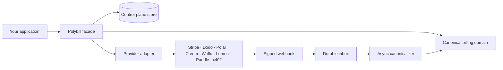

# Polybill

### Provider-neutral billing for TypeScript and Cloudflare Workers

Polybill gives your product one canonical billing model while payment providers change behind an
adapter boundary. Keep your catalog, orders, payments, refunds, subscriptions, entitlements, and
vouchers portable—and make failure recovery explicit.

<p>
  
  
  
</p>

> **Status:** experimental. Adapters have deterministic offline and Worker coverage, but no provider
> is promoted to stable until sandbox and production evidence is recorded. Do not use this
> repository as proof of payment compliance or provider compatibility.

## Why Polybill?

Payment integrations usually spread provider IDs and statuses through business code. That makes a
provider switch expensive and turns timeouts, duplicate webhooks, and partial failures into
accounting bugs. Polybill keeps the business model provider-neutral and treats every external
response as evidence that must be validated.

- **One domain model:** branded IDs, decimal minor-unit money, immutable prices, explicit lifecycle
  states.
- **Failure-aware mutations:** idempotency is claimed before transport; unknown outcomes recover
  through provider read-back or reconciliation instead of blind retries.
- **Webhook safety:** verify raw bytes, persist an inbox record, then canonicalize asynchronously.
  Duplicate and out-of-order delivery is expected.
- **Tenant and environment isolation:** test/live credentials, mappings, evidence, and idempotency
  keys cannot cross connection boundaries.
- **Edge-first runtime:** the default import graph is Web API and Cloudflare Workers friendly; Node
  helpers live in an explicit example app.
- **Portable entitlements:** licenses, vouchers, and redemption state belong to Polybill and survive
  a provider migration.

## Supported adapters

All adapters are currently `experimental`; capability snapshots report whether an operation is
`native`, `emulated`, or `unsupported`.

| Provider       | Package                           | Notes                                                            |
| -------------- | --------------------------------- | ---------------------------------------------------------------- |
| Stripe         | `@polybill/provider-stripe`       | Checkout, payment, refund, subscription and webhook flows        |
| Dodo Payments  | `@polybill/provider-dodo`         | Hosted checkout and MoR-oriented flows                           |
| Polar          | `@polybill/provider-polar`        | Product alternatives; canonical multi-item carts are unsupported |
| Creem          | `@polybill/provider-creem`        | Hosted checkout with validated custom pricing                    |
| Waffo Pancake  | `@polybill/provider-waffo`        | Waffo Pancake MoR adapter                                        |
| Lemon Squeezy  | `@polybill/provider-lemonsqueezy` | Checkout, subscriptions and signed webhooks                      |
| Paddle Billing | `@polybill/provider-paddle`       | Billing checkout and full refunds                                |
| x402           | `@polybill/provider-x402`         | One-time USDC settlement through `x402-paysdk`                   |

Direct recurring mandate portability, provider-native license ownership, and financial-card issuance
are intentionally outside the current contract.

## Architecture



The control-plane store is deliberately small. Polybill does not take over your user table or
business order table. Use the memory store for tests and local experiments; use D1 (or another
implementation of the store ports) for durable deployments.

## Quick start

Requirements: Node.js 20+, pnpm 11+.

```bash
git clone https://github.com/backrunner/polybill.git
cd polybill
pnpm install
pnpm build
pnpm test
```

The Node example starts a local webhook endpoint and capability endpoint:

```bash
pnpm --filter @polybill/example-node build
POLYBILL_API_KEY=replace-me \
POLYBILL_WEBHOOK_SECRET=replace-me \
pnpm --filter @polybill/example-node start
```

For an application, compose the facade with a provider adapter and a store:

```ts
import { createPolybill } from "polybill";
import { createStripeAdapter } from "@polybill/provider-stripe";
import { createMemoryStore } from "@polybill/store-memory";

const billing = createPolybill({
  tenantId,
  connection: {
    id: connectionId,
    tenantId,
    provider: "stripe",
    environment: "test",
  },
  credentials: { apiKey: process.env.STRIPE_SECRET_KEY! },
  adapter: createStripeAdapter(),
  store: createMemoryStore(),
});

const checkout = await billing.checkouts.create({
  idempotencyKey,
  items: [{ priceId, quantity: 1 }],
  successUrl: "https://merchant.example/success",
  cancelUrl: "https://merchant.example/cancel",
});
```

Use a durable store and secret manager in production. Checkout completion is not treated as
financial finality; reconcile the payment or consume verified provider evidence before high-value
fulfillment.

## Development and verification

```bash
pnpm format:check
pnpm lint
pnpm typecheck
pnpm test:unit
pnpm test:contract
pnpm test:workerd
pnpm test:migration
pnpm test:security
pnpm check:packages
pnpm check:worker-bundle
```

Provider documentation, capability limits, migration rules, threat model, webhook contracts, and the
latest payment review are in [`/.agents`](./.agents/README.md). Start with the
[payment security review](./.agents/PAYMENT_REVIEW_2026-09-06.md) before adding an adapter or
changing a lifecycle transition.

## Contributing

Open an issue or pull request with a focused change, a contract test, and the relevant provider
documentation. Changes that affect canonical fields, state transitions, capabilities, storage
invariants, or webhook semantics must update the corresponding design document and include a
changeset.

## License

Polybill is released under the [Apache License 2.0](./LICENSE).
